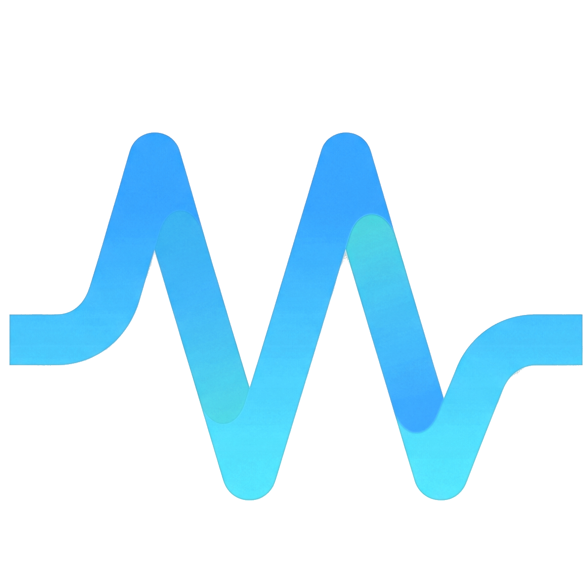

# VSTDeck

### Visual Audio Plugin Manager & Studio Deck for Modern Audio Engineering

---

Welcome to the **VSTDeck** open-source audio workstation ecosystem.

We build high-performance, crash-isolated visual studio tools designed to help music producers, sound designers, and mixing engineers inspect, catalog, visually preview, and organize their entire VST audio plugin library outside of the Digital Audio Workstation.

---

### ⚡ What Makes VSTDeck Different

- 🛡️ **12-Second Out-of-Process Watchdog**: Never lets a bad VST, memory fault, or modal licensing popup hang or crash your studio workspace.
- 📸 **100% Background-Always Native GUI Capture**: True 32-bit Win32 offscreen snapshots via DWM cloaking with zero window flashing and zero focus stealing.
- 🔍 **Instant 4-Way Discovery**: Sub-millisecond filtering across Name, Vendor, 15 standardized Pro-Audio DAW categories, or visual UI recognition.
- 🗂️ **Multi-Format Deduplication**: Automatic VST3 precedence over legacy VST2, Reaper-style custom directory management, and persistent SQLite quarantine logging.

---

### 📦 Ecosystem Repositories

| Repository | Description | Status / Stack |
| :--- | :--- | :--- |
| [**`vstdeck/vstdeck`**](https://github.com/vstdeck/vstdeck) | **Flagship Desktop Application & Scanner Engine** The open-source core deck (React 19, Tailwind CSS v4, Tauri 2, SQLite) and out-of-process C++20 / JUCE 8 scanner (`VSTDeck-Scanner.exe`). | Open Source (MIT) Rust • C++20 • React 19 |

---

**Explore the projects, join the discussions, or contribute:**

[**Main Application Repository →**](https://github.com/vstdeck/vstdeck) • [Releases](https://github.com/vstdeck/vstdeck/releases) • [Discussions](https://github.com/vstdeck/vstdeck/discussions) • [Issue Tracker](https://github.com/vstdeck/vstdeck/issues)

